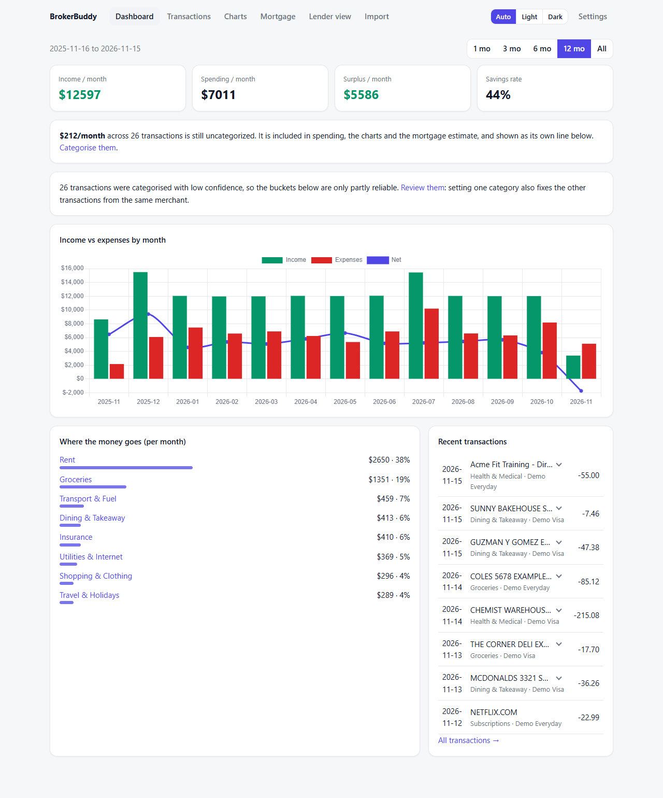
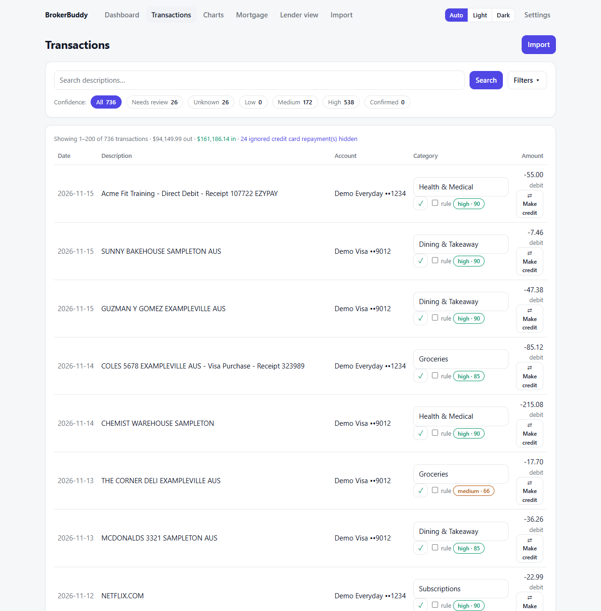
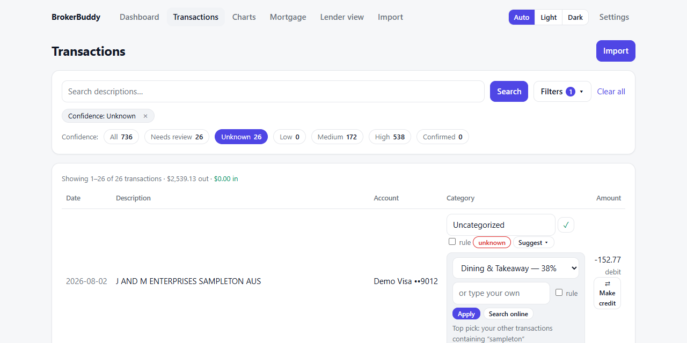
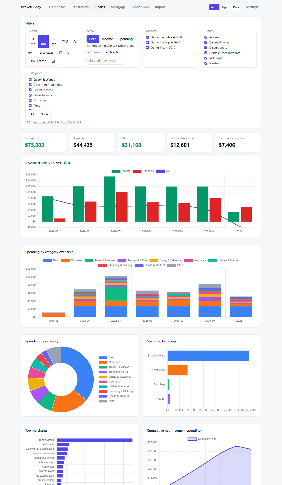
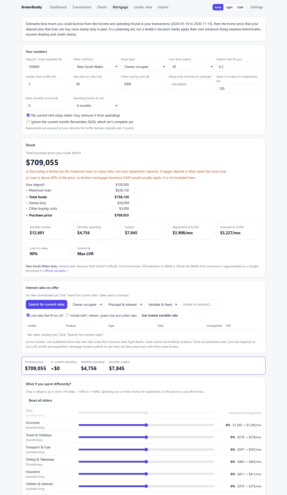

# BrokerBuddy

A private, self-hosted money dashboard for Australian households. Import bank CSVs or PDF statements (or link a bank through Plaid), have every transaction sorted into the categories a mortgage lender looks at, see where the money goes, and estimate how much you could borrow for a home.

Your data stays on your computer, in one SQLite file. There are no paid services and no accounts to create.



## Highlights

- **Import anything:** CSV with automatic column mapping, text-based PDF statements with automatic table detection, or optional Plaid linking.
- **Lender-style categorisation:** about 30 categories grouped as Income, Essential, Discretionary, Debts, Risk flags and Neutral, with a confidence score on every transaction, learning from your corrections, and optional merchant lookups.
- **Fix things quickly:** a review list of doubtful transactions, suggested categories with scores, one edit fixes every transaction from the same merchant.
- **Credit cards and repayments:** card repayments are not double counted, and small credits from friends offset the spending they relate to.
- **Dashboard, charts and a lender view** for income, spending and surplus.
- **Mortgage planner:** borrowing capacity, stamp duty for every state, live market rates, and spending sliders that recalculate the price you could afford.
- **Categorise from your phone:** an optional Telegram bot asks about one uncategorised transaction a day, suggests categories, and applies your reply.
- **Private and secure:** secrets encrypted at rest, password login, HTTPS (self-signed, Let's Encrypt or your own certificate), nothing personal ever sent to lookups.
- **Light, dark and auto themes.** All configuration is in the web interface.

## Quick start

**Download** a build for Windows, macOS or Linux (Intel or ARM) from the [Releases](https://github.com/This-will-be-your-username/brokerbuddy/releases) page, run it, and open **https://127.0.0.1:8443**. Or use Docker:

```
docker run -d -p 127.0.0.1:8443:8443 -v brokerbuddy-data:/data ghcr.io/this-will-be-your-username/brokerbuddy:latest
```

Or run from source with a recent [Go](https://go.dev/dl/) (the version is in `go.mod`):

```
go run .
```

Step by step guides for each platform are in [Installing and running](wiki/Installing-and-Running.md).

Open **https://127.0.0.1:8443** (accept the self-signed certificate warning once) and go to **Settings**.

To explore with fictional data and no real bank details, run a separate demo database:

```
go run . -db demo.db -demo
```

| Flag | Default | Meaning |
|------|---------|---------|
| `-db` | `brokerbuddy.db` | where your data lives |
| `-addr` | `127.0.0.1:8443` | local address for the web UI |
| `-demo` | off | fill an empty database with a year of fictional transactions |
| `-version` | | print the version and exit |

On first run an encryption key is created next to the database (`brokerbuddy.db.key`). **Back up both files together**, or use **Settings → Backup & migration** to export everything (key included) as a single file and import it on another machine. Importing replaces all existing data.

## Screenshots

| | |
|---|---|
|  |  |
|  |  |

More are in the wiki, all taken with the built-in demo data.

## Documentation

Full documentation lives in the **[repository wiki](https://github.com/This-will-be-your-username/brokerbuddy/wiki)**:

- [Installing and running](wiki/Installing-and-Running.md): downloads for Windows, macOS and Linux, Docker, services
- [Getting started](wiki/Getting-Started.md) and [demo data](wiki/Demo-Data.md)
- [Importing data](wiki/Importing-Data.md): CSV, PDF and Plaid
- [Categorisation](wiki/Categorisation.md): how transactions are classified, confidence scores, rules, learning, suggestions, reprocessing
- [Transactions](wiki/Transactions.md): filters, review, ignored rows, repayments from others, reversing direction
- [Credit cards](wiki/Credit-Cards-and-Repayments.md)
- [Dashboard, charts and lender view](wiki/Dashboard-Charts-and-Lender-View.md)
- [Mortgage planner](wiki/Mortgage-Planner.md)
- [Settings, security and HTTPS](wiki/Settings-and-Security.md)
- [Privacy](wiki/Privacy.md)
- [Architecture](wiki/Architecture.md), [development and testing](wiki/Development-and-Testing.md) and [releases and CI](wiki/Releases-and-CI.md)
- [FAQ and troubleshooting](wiki/FAQ-and-Troubleshooting.md)

The wiki pages are also kept in this repository under [`wiki/`](wiki/), so they are versioned with the code. See [publishing the wiki](scripts/publish-wiki.sh) to push them to the GitHub wiki.

## Limits

BrokerBuddy is a planning aid, not financial advice and not a lender's serviceability calculation. Lenders apply their own living-expense benchmarks, income shading and credit checks. PDF import supports text-based statements only (no OCR). Tax, investments and budgets are out of scope.

## Test

```
go test ./...
```
