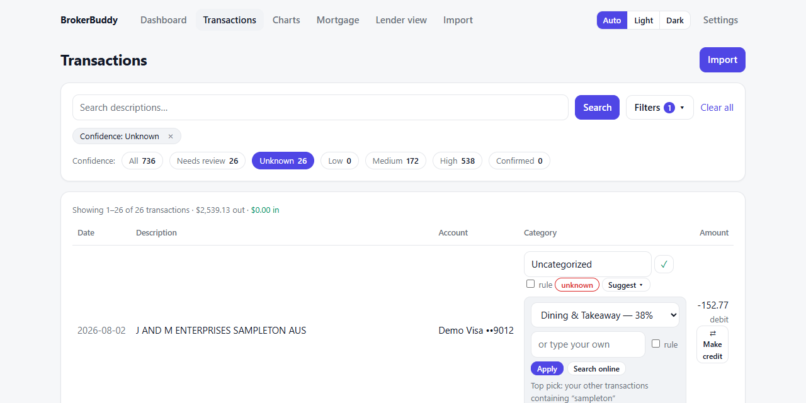

# Categorisation

Every transaction is placed in one of about 30 categories, chosen around what Australian mortgage lenders examine on statements. The app always makes an attempt, gives it a confidence score, and learns from your corrections.

## Categories

| Group | Categories |
|-------|------------|
| Income | Salary & Wages, Government Benefits, Rental Income, Other Income |
| Essential living | Groceries, Rent, Home & Strata, Utilities & Internet, Insurance, Health & Medical, Transport & Fuel, Education & Childcare |
| Discretionary | Dining & Takeaway, Entertainment, Subscriptions, Shopping & Clothing, Personal Care, Travel & Holidays, Alcohol & Tobacco, Pets, Gifts & Donations |
| Debts & commitments | Mortgage & Loan Repayments, Credit Card Repayments, Buy Now Pay Later, Child Support, Tax |
| Risk flags | Gambling, Cash Withdrawals, Fees & Dishonours, Short-term Credit |
| Neutral | Transfers, Savings & Investments, Uncategorized |

Risk flags are things an assessor may ask about. Neutral categories are not counted as income or spending, except **Uncategorized spending, which is counted as spending** so totals are never understated.

## How a transaction is classified

The classifier works down this list and stops at the first answer. Every answer carries a confidence from 0 to 100.

| Order | Source | Confidence | Notes |
|-------|--------|-----------|-------|
| 1 | You set it by hand | 100 (*confirmed*) | Never changed automatically. The most recent edit wins if you changed your mind. |
| 2 | Your rules | 95 | A text pattern you gave. Wins over everything automatic. |
| 3 | Learned from your edits | 90 strong, 60 weak | Similar names follow your earlier choices. |
| 4 | Built-in dictionary | 66 to 90 | National brands score higher than ordinary words like "cafe". |
| 5 | Bank-supplied category | 50 to 55 | From Plaid or a CSV category column. |
| 6 | Online lookup | 50 | Cached result of a Wikipedia lookup you triggered. |
| 7 | Typo of a known brand, or a run-together name ending in a business word | 50 to 52 | Example: "primemeat" ends in "meat". |
| 8 | Similar to something in your history | 70 if identical, up to 45 if a look-alike | Look-alikes are always shown as low. |
| 9 | Wording cues | 20 to 45 | Words like "fee", or unexplained money in. |
| 10 | Nothing matched | 0 (*unknown*) | Left as Uncategorized. |

Guesses (typo, history, cues) are never used as evidence for further guesses, so errors cannot feed on themselves.

### Confidence levels

| Level | Score | Meaning |
|-------|-------|---------|
| Confirmed | set by you | Final |
| High | 80 and above | Very likely right |
| Medium | 50 to 79 | Plausible. A brand name beats a generic word. |
| Low | 1 to 49 | A guess to review |
| Unknown | 0 | Nothing matched |

Direction matters: a salary credit is income but a debit with the same wording is not, and a debit is never learned as income.

## Cleaning the description first

Bank text carries wording about how a payment was made, not who was paid. Before matching, the app ignores:

- `- Visa Purchase`, `- Direct Debit` and similar
- `Receipt 139006`
- foreign currency notes (`Foreign Currency Amount: USD 9.99`)
- page footer text that PDF import can pick up (copyright lines, bank names)
- the merchant before a `CRED VOUCHER` marker (the real payee follows it)
- payment-processor prefixes such as `SQ *`, `ZLR*`, `SMP*`, `LSP*`

So the same shop looks the same however it was paid. Stored descriptions are not changed.

## The built-in dictionary

A dictionary of Australian merchants and bank phrases (supermarkets, fuel, telcos, energy, insurers and health funds, airlines and hotels, subscriptions, billing platforms, and so on) plus **generic business words** such as butcher, patisserie, physiotherapy, cellars, swim school. Matching is on whole words, longest phrase first, so "coles express" beats "coles". Ordinary words score lower than brands.

Local businesses are deliberately **not** listed: words and national brands generalise, a suburb's shops do not. Set the category once ([below](#fixing-things)) and the app remembers.

## Learning from your edits

Every category you set by hand becomes an example. Similar transactions follow automatically and are marked *learned*:

- Same business name, ignoring store numbers and suburbs, tolerating typos (`ZORBA` and `ZORBAS`).
- A full match beats the built-in dictionary.
- A brand-only match (you categorised `COLES EXPRESS`, a new one says `COLES`) is used only where the dictionary has no answer, and is skipped if your examples for that brand disagree.
- Your explicit rules still win.

## Fixing things

### The review list

After an import, you go to **Needs review** when anything is low or unknown. On **Transactions**, the confidence chips filter the list and show counts. The review list shows the least sure first, with the same merchants together.

### Changing a category

Type a category in the box (or press **✓** to confirm the suggestion). Then:

1. The transaction becomes *confirmed*.
2. The app looks through your history. Other transactions from the same merchant, and anything close to it, take the category too, unless you set them yourself. The page says how many changed.
3. Tick **rule** to also save a text rule for that merchant.

### Suggestions for doubtful transactions

Rows that are unknown or low confidence have a **Suggest ▾** button. It opens a drop-down of likely categories, each with a likelihood score and a reason:

- the app's own best guess,
- what you chose for other transactions containing the same distinctive word,
- a name ending in a business word,
- if there are few ideas, your most-used categories at a low score.

Pick one and press **Apply**, or type your own category in the box beside it. **Search online** adds candidates from Wikipedia for that merchant. Only the cleaned business name is sent, never amounts, dates or accounts, and answers are cached ([Privacy](Privacy)).

### Merchant lookups

**Settings → Categorisation → Look up unknown merchants** looks up the 12 biggest unknown merchants on Wikipedia. Results are marked *lookup*, listed in Settings, and can be rejected (a rejected one is not looked up again). Wikipedia knows chains, not local shops.

### Rules

**Settings → Categorisation** lists your rules: a text the description contains and a category. Rules win over everything automatic.

## Reprocessing existing transactions

After an update to the parsing or categorisation logic, **Settings → Categorisation → Reprocess existing transactions** brings stored data up to date:

1. **Preview changes** shows how many transactions would change category, how many descriptions have leftover footer text, before and after counts of unknown, low, medium and high confidence, and a sample of the changes. Nothing is written.
2. **Apply changes** removes leftover footer text and re-categorises everything you have not confirmed yourself.

Your confirmed categories, rules, dates and amounts are never touched, and running it again changes nothing further. The app also does this automatically at startup.

## Unknown spending is still counted

Uncategorized spending is included in the dashboard totals, the charts, the Lender view and the mortgage estimate, and appears as its own line and a notice so you can find it. See [Dashboard, charts and lender view](Dashboard-Charts-and-Lender-View).
