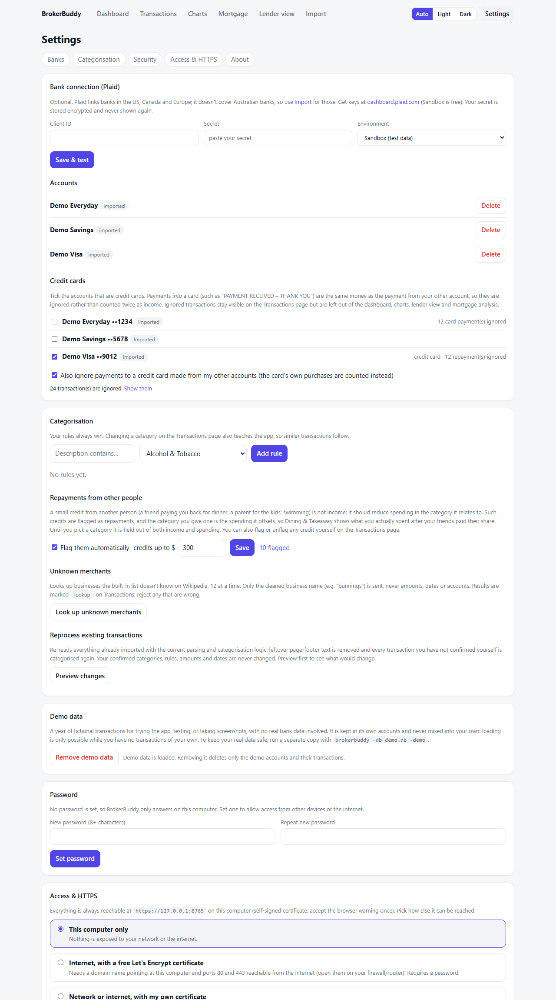

# Credit cards and repayments

## The problem

If you import both your everyday account and your credit card, the money you pay to the card appears twice: once as a payment out of the everyday account and once as a payment into the card. Counting both double counts spending (the purchases are already on the card) and makes the card payments look like income.

## What BrokerBuddy does

Flag an account as a **credit card** (while importing, or under **Settings → Banks → Credit cards**). A card statement is recognised from lines such as "PAYMENT RECEIVED - THANK YOU", and Plaid marks credit accounts for you.

Then:

1. **Payments into the card** (on the card's own statement) are ignored.
2. **Payments to the card** from your other accounts (the "Credit Card Repayments" category) are ignored too. This is switchable under Settings ("Also ignore payments to a credit card made from my other accounts"). The card's own purchases are counted instead.
3. **Refunds, rewards and interest on the card still count.**

Ignored transactions are not deleted. They remain in the database, so re-importing does not bring them back. They are left out of the dashboard, charts, Lender view and mortgage analysis.

## Seeing and overriding

- Transactions → Filters → *Ignored transactions* → *Show with the others* or *Only ignored*.
- Ignored rows are dimmed and show the reason on hover.
- **Count it** includes one anyway. **Ignore** (on a row you included) goes back to automatic.
- The Transactions page says how many ignored rows are hidden.

## Card statements with an unusual sign

Some card exports show purchases as positive numbers and payments as negative, others the reverse. For a single amount column, the importer learns the direction from the "payment received" lines, and you can invert it with the sign switch.

## Related

[Transactions](Transactions), [Importing data](Importing-Data), [Settings and security](Settings-and-Security).
