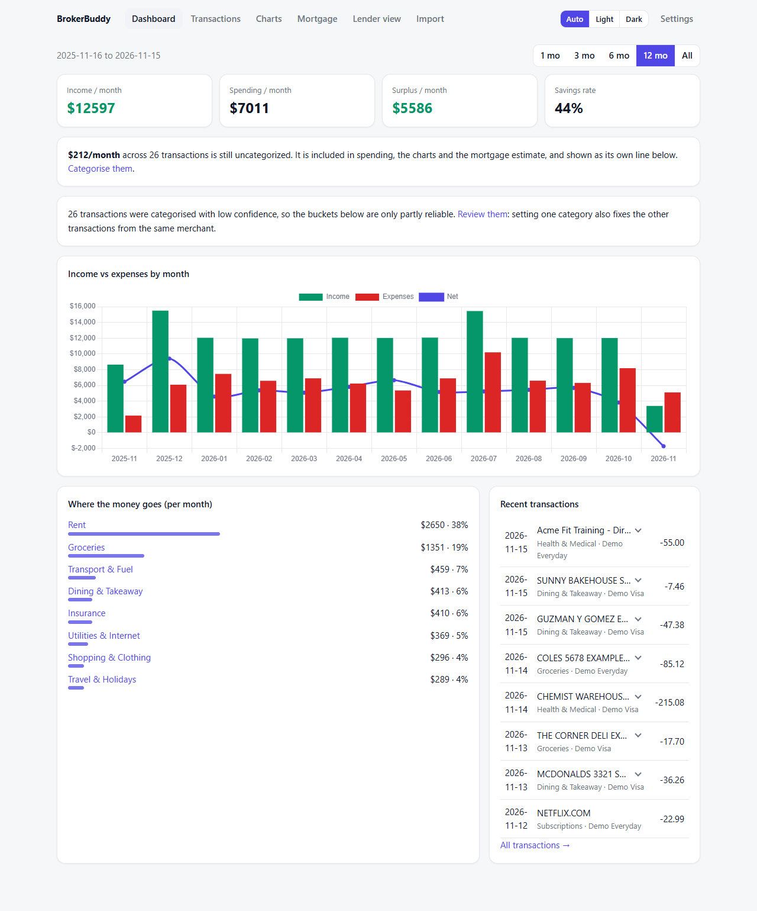
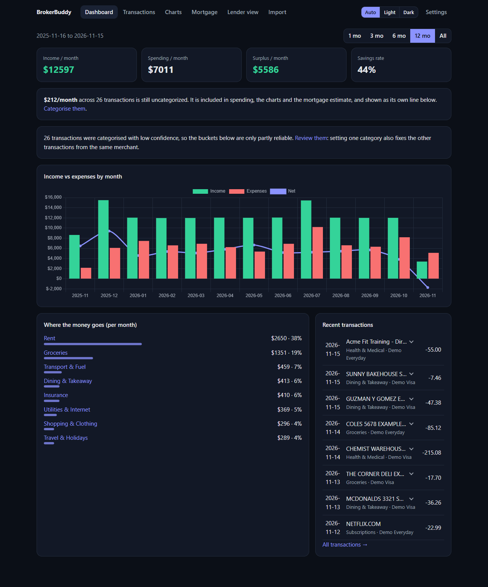
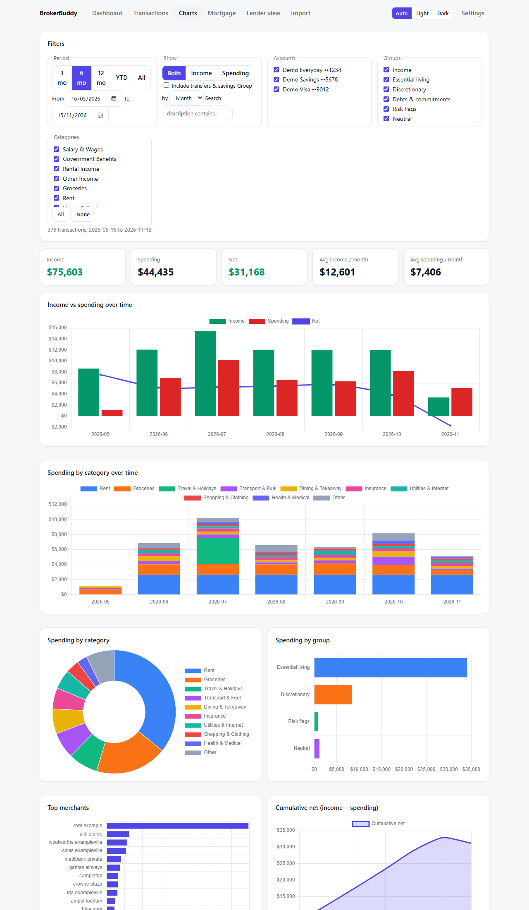
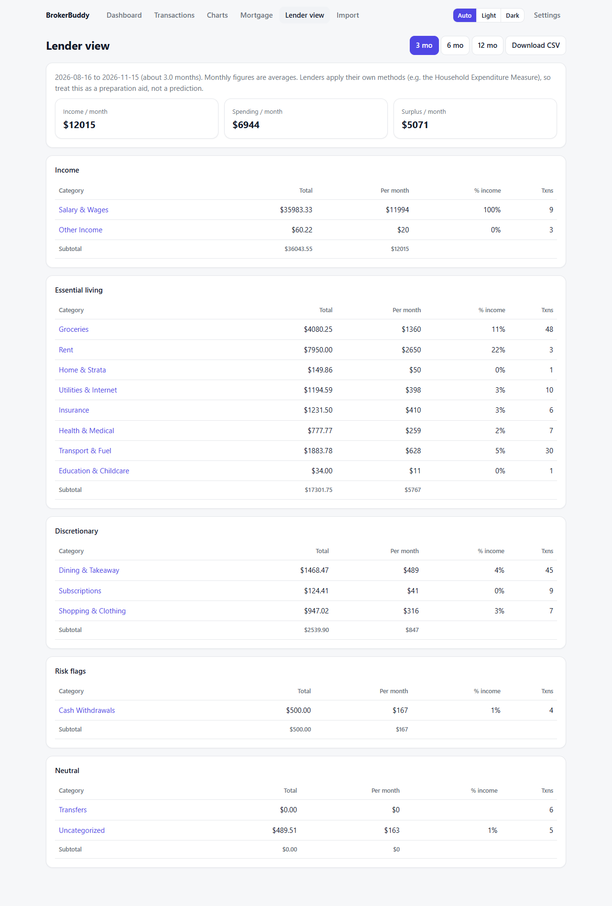

# Dashboard, charts and lender view

## How income and spending are worked out

All analysis pages use the same rules:

- **Income** is credits in the income categories (Salary & Wages, Government Benefits, Rental Income, Other Income).
- **Spending** is debits, net of refunds, in every category except income and the neutral ones (Transfers, Savings & Investments).
- **Uncategorized spending counts as spending**, so totals are never understated. It is shown on its own line.
- **Ignored transactions** (credit card repayments) are left out ([Credit cards](Credit-Cards-and-Repayments)).
- **Repayments from other people** reduce spending in the category they relate to ([Transactions](Transactions#repayments-from-other-people)).
- Monthly averages divide by whole months in the period, because pay cycles land in whole months.

## Dashboard

The main page (`/`):

- Period selector: 1, 3, 6 or 12 months, or all time.
- Four figures: income, spending, surplus and savings rate.
- Notices: how much uncategorized spending there is (with a link to categorise it) and how many transactions have low confidence (with a link to review them).
- **Income vs expenses by month**: bars for income and expenses with a net line. The current month is usually partial, so it looks low.
- **Where the money goes**: top categories per month with their share of spending. Each links to the matching transactions.
- **Recent transactions.**

## Charts

The Charts tab filters by period (3, 6 or 12 months, year to date, all, or a custom range), income or spending, accounts, groups, categories, search text, and day, week or month grouping. You can include transfers and savings. Filtering happens in the browser, so it is instant.

Views:

1. Income vs spending over time, with net.
2. Spending by category over time (stacked).
3. Spending by category (a doughnut; click a slice to filter).
4. Spending by group.
5. Top merchants.
6. Cumulative net (income minus spending).
7. Spending by weekday.
8. The largest transactions.

## Lender view

`/report` shows what an assessor would see:

- 3, 6 or 12 month averages by group and category, with each as a percentage of income.
- Income, spending and surplus.
- **Things an assessor may notice**, each rated: gambling transactions, short-term or payday credit, buy-now-pay-later, dishonour and overdrawn entries, bank fees, high cash withdrawals (about $300 a month or more), no income detected, no rent or loan payments found, and a large share of uncategorized spending.
- How much spending repayments from others reduced, and any waiting for a category.
- A **CSV download** of the summary.

It is a preparation aid, not a serviceability calculation.
