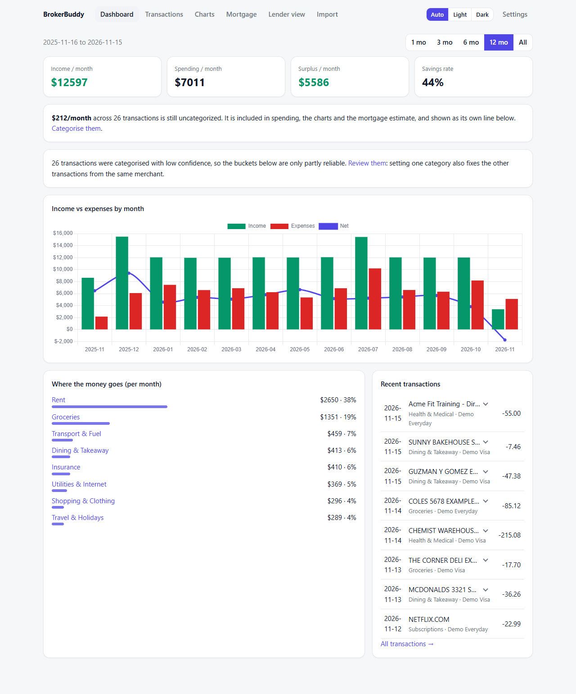
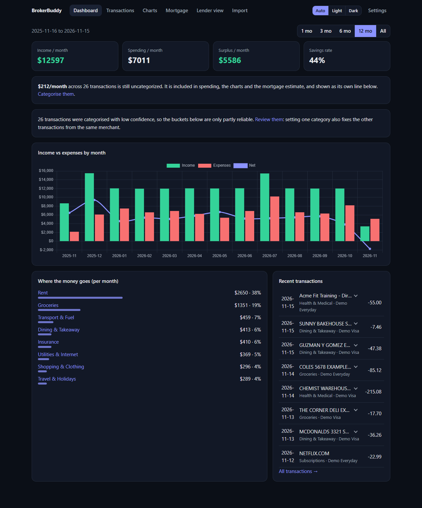
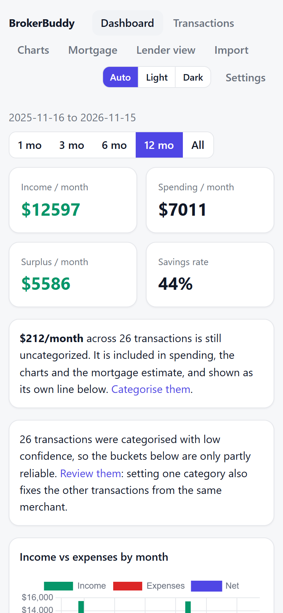

# BrokerBuddy

BrokerBuddy is a private, self-hosted money dashboard for Australian households. It imports bank transactions, sorts them into the categories mortgage lenders care about, shows income and spending, and estimates how much you could borrow.

Everything below was captured with the built-in [demo data](Demo-Data): fictional people, shops and amounts.

## What it does

| Area | What you get | Read more |
|------|--------------|-----------|
| Import | CSV with automatic column mapping, PDF statements with table detection, optional Plaid | [Importing data](Importing-Data) |
| Categorisation | About 30 lender-oriented categories, a confidence score on each transaction, learning from your edits, merchant lookups, suggestions | [Categorisation](Categorisation) |
| Review | Filters, a review list, same-merchant fixes, reversing debit/credit | [Transactions](Transactions) |
| Credit cards | Repayments ignored so spending is not double counted | [Credit cards](Credit-Cards-and-Repayments) |
| Repayments from others | Small credits from friends offset the spending they relate to | [Transactions](Transactions#repayments-from-other-people) |
| Analysis | Dashboard, seven chart views, a lender summary | [Dashboard, charts, lender view](Dashboard-Charts-and-Lender-View) |
| Mortgage | Borrowing capacity, stamp duty, market rates, spending sliders | [Mortgage planner](Mortgage-Planner) |
| Running it | Downloads for Windows, macOS and Linux, Docker images, running as a service | [Installing and running](Installing-and-Running) |
| Security | Encrypted secrets, password login, HTTPS options | [Settings and security](Settings-and-Security) |

## Dark mode

The top bar has an Auto, Light and Dark switch. Auto follows your system.

## Works on a phone

The layout adapts to narrow screens.

## Start here

1. [Installing and running](Installing-and-Running): Windows, macOS, Linux or Docker.
2. [Getting started](Getting-Started): first steps.
3. [Demo data](Demo-Data): look around without any real data.
4. [Importing data](Importing-Data): bring in your own statements.
5. [Categorisation](Categorisation): understand and correct the results.

## Important limits

BrokerBuddy is a planning aid, not financial advice, and not a lender's serviceability calculation. See the [mortgage limits](Mortgage-Planner#what-is-not-modelled).
