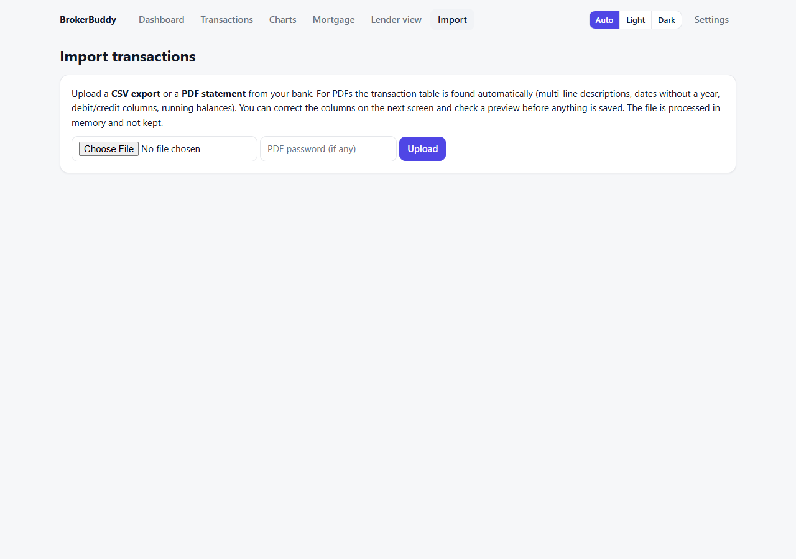

# Importing data

There are three ways to get transactions in. No paid service is needed for any of them.

| Method | Best for | Needs |
|--------|----------|-------|
| [CSV](#csv) | Any bank that offers an export | A downloaded file |
| [PDF](#pdf-statements) | Statements without a CSV option | A text-based PDF |
| [Plaid](#plaid-optional) | US, Canada and Europe | Free sandbox or paid keys |

Australian banks are not covered by Plaid, so use CSV or PDF for them.

## CSV

1. **Import** → upload the file.
2. The app skips lines before the header, detects the delimiter (comma, semicolon, tab), finds the header row, and guesses the date, description, amount (or separate debit and credit) columns and the date format.
3. Fix any guess with the drop-downs. The preview shows how each row will be read, including its category and confidence.
4. Choose the account (or create one) and tick **credit card** if it is one.
5. Import.

Supported layouts:

- One signed amount column, or separate Debit and Credit columns.
- Optional second description column, optional bank category column.
- Date formats such as `dd/mm/yyyy`, `yyyy-mm-dd`, `dd Mon yyyy`.
- UTF-8 (with or without a byte order mark) and Latin-1 files.
- A sign inversion switch, for banks that show spending as negative or positive.

Not supported: amounts with a decimal comma (`4,50`).

**Remembered mappings.** The mapping is saved per header layout, so the next export from the same bank is one click.

## PDF statements

Upload a PDF on the same page. The table is found automatically and shown in the same mapping and preview screen before anything is saved.

How the table is found:

1. Text and positions are read from every page and rebuilt into lines and cells (including statements whose text is drawn glyph by glyph).
2. The table is located from its header row, even when headings wrap over several lines. Without a header, rows that start with a date and end in amounts are used.
3. Numeric columns are located by clustering the x positions of the amounts and labelled from the header.
4. Wrapped descriptions are re-joined, a date printed once per day carries to the rows below, and dates without a year take it from the statement period.
5. Money in and out comes from Debit and Credit columns, `CR` and `DR` markers, or the running balance. Newest-first statements are handled.
6. Opening and closing balances, totals, repeated headers and page footers (legal text, page numbers, web addresses) are dropped.

Tested layouts (synthetic statements in `testdata/pdf`): debit, credit and balance columns; CR and DR markers; credit card with one signed column; no header at all; newest first with one unsigned amount; date once per day with wrapped headings; two date columns; monospace text statements.

Limits:

- Text-based PDFs only. A scan or photo has no text and needs OCR, which is not included.
- Password-protected files need the password entered on the upload form. It is used once and not stored.
- PDF 2.0 files, and statements combining several accounts with different layouts in one file, may not read correctly.

Always check the preview. Use CSV when your bank offers it.

## Plaid (optional)

Under **Settings → Banks** enter a Plaid client id and secret (the secret is stored encrypted and never shown again). The Transactions page then shows **Connect a bank** and **Sync now**. Transactions are pulled with Plaid's cursor-based sync, applied atomically, and your manual categories survive re-syncs. A direction you reversed is kept ([Transactions](Transactions#reversing-debit-and-credit)).

## Duplicates and re-importing

Re-importing a statement, or an overlapping export, is safe:

- Each row gets a stable id from the account, date, amount and description. Identical rows on one day are told apart by occurrence number, so two genuine identical purchases are both kept.
- Rows stored by an older version of the app under a different description (for example with page-footer text attached) are recognised by account, date, amount and the start of the description, and are not added again.

## After importing

The import summary tells you how many transactions were added and how many were duplicates, and takes you to the **Needs review** list when anything is uncertain. See [Categorisation](Categorisation).
