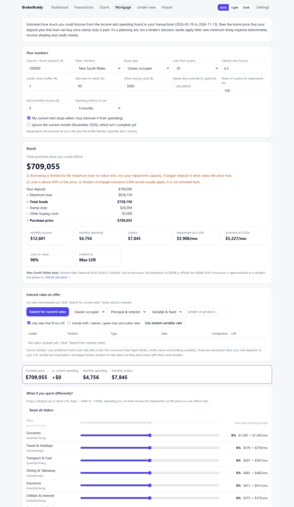

# Mortgage planner

The Mortgage tab estimates how much you could borrow from the income and spending found in your transactions, then the home price your deposit plus that loan can buy once stamp duty is paid. It recalculates as you change anything.

## Inputs

| Input | Meaning |
|-------|---------|
| Deposit | Your down payment |
| State or territory | Selects the stamp duty schedule |
| Buyer type | Owner-occupier, first home buyer or investor |
| Loan term | Years |
| Interest rate | Type one, or pick one from the market list |
| Lender stress buffer | Points added to the rate when assessing repayments (default 3, like lenders use) |
| Maximum loan-to-value | Caps the loan as a share of the price (default 90%) |
| Other buying costs | Legal fees, inspections and so on |
| Stamp duty override | Type the figure from your state's official calculator instead of the built-in one |
| Share of surplus for repayments | How much of your monthly surplus you would commit |
| Extra monthly income | Income not in your transactions |
| Spending history to use | 1 to 24 months |

Two tickboxes:

- **My current rent stops when I buy** (on by default) removes the Rent category from spending.
- **Ignore the current month** leaves this calendar month out of the averages, because it is only partly complete. The analysed window then ends at the last transaction before it. The choice is remembered.

## How the result is calculated

1. **Monthly surplus** = average monthly income minus average monthly spending over the chosen history, using the [same rules as the dashboard](Dashboard-Charts-and-Lender-View#how-income-and-spending-are-worked-out). Existing loan repayments, credit cards and buy-now-pay-later stay in as spending. Uncategorized spending is treated as spending.
2. **Borrowing capacity** is the loan whose repayment, assessed at *your rate plus the stress buffer*, fits in the share of surplus you chose, over the loan term.
3. **Maximum loan** is the smaller of that and the maximum loan-to-value share of the price.
4. **Purchase price** solves `price + stamp duty + other costs = deposit + loan`.

The result shows the deposit, loan, total funds, stamp duty, other costs and price, the repayment at your rate and the assessed repayment, the loan-to-value ratio, and what limited the loan (repayment capacity or the maximum LVR). It warns when spending is at or above income, when the loan is limited by LVR, and when the loan is above 80% of the price (lenders mortgage insurance would usually apply).

## Spending sliders

Below the result, each spending category has a slider from -100% to +100% in 1% steps. As you drag, the category's monthly amount, the surplus and the purchase price recalculate. Cutting spending frees money for repayments, so the price you can afford rises. **Reset all sliders** puts them back.

## Stamp duty

Duty schedules are built in for every state and territory, with an owner-occupier schedule where it differs, first-home-buyer concessions and an investor schedule. Each state carries a status note saying how well the numbers were checked (for example, NSW general rates are official for 2026/27). Several concessions changed in 2026 and are flagged *verify*. Where a first-home-buyer band is approximate, a straight-line phase-in is used. A link goes to the official calculator, and you can type your own figure in the override.

## Interest rates on offer

**Search for current rates** downloads every home-loan rate that Australian banks, credit unions and building societies publish under the Consumer Data Right. It is free, needs no key and takes about a minute (around 90 lenders and 8,000 rates). Filter by buyer purpose, principal and interest or interest only, variable or fixed, and lender or product name, and **Use lowest variable rate** fills the rate. Staff, veteran, green-loan and other special-eligibility products and rate outliers are hidden unless you tick the box.

Mortgage brokers do not publish a feed, so they cannot be listed. They place loans with these same lenders. The demo screenshots show an empty rates list because no download was made.

## What is not modelled

- Lenders mortgage insurance.
- Lenders' minimum living-expense benchmarks (HEM).
- Income shading, such as counting 80% of rental income.
- HECS or HELP repayments and credit card limits.
- Lender-specific policies, credit history and serviceability buffers other than the one you enter.

Treat the result as a planning aid, not financial advice or a lender's decision.
