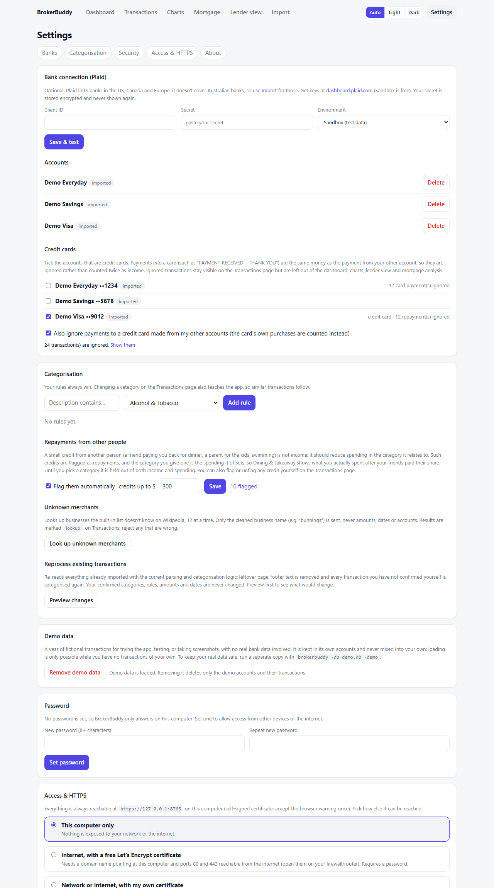

# Settings and security

All configuration is done in the web interface under **Settings**. There are no environment variables and no config files. The only startup options are the [flags](Getting-Started#startup-options).

## Settings sections

| Section | What it controls |
|---------|------------------|
| Banks | Optional Plaid keys, connected and imported accounts, credit card flags |
| Categorisation | Your rules, repayments from other people, merchant lookups, reprocessing |
| Demo data | Load or remove the [demo data](Demo-Data) |
| Password | Set or remove the password |
| Access & HTTPS | Who can reach the app and over what certificate |
| Your data | Where the database and key file are, how to back up |

## Password

With **no password**, the app answers only on this computer: it refuses requests whose Host header is not local, which also blocks DNS-rebinding attacks from other websites.

With a password (8 or more characters):

- Passwords are stored as bcrypt hashes.
- Sign-in is rate limited per client address.
- Sessions use a cookie that is HTTP-only and secure.
- Anything beyond this computer (an internet or network address) **requires** a password.

## Access and HTTPS

The app is always reachable at `https://127.0.0.1:8443` (or your `-addr`) on the same computer, with a self-signed certificate that is generated once and kept. Choose how else it can be reached:

| Mode | Use when | Needs |
|------|----------|-------|
| This computer only | Default | Nothing |
| Internet, with a free Let's Encrypt certificate | You want access from anywhere | A domain pointing at this computer, ports 80 and 443 reachable, a password |
| Network or internet, with my own certificate | You already have a certificate | Paste the certificate and private key (PEM), a password |

Changes apply immediately, with no restart. The local address always stays available, so a wrong setting cannot lock you out. A staging option for Let's Encrypt lets you test without hitting rate limits.

## Protection against cross-site requests

Every form post is checked: it must come from the same origin (the browser's `Sec-Fetch-Site` header, falling back to `Origin` or `Referer`). A request from another site is rejected with "cross-origin request blocked". The app sends `Referrer-Policy: same-origin`, so nothing leaks to other sites while same-site posts keep a real Origin.

## Secrets at rest

Secrets in the database (Plaid secret, bank access tokens, the private key of an imported certificate) are encrypted with AES-GCM. The key is generated on first run and stored next to the database as `<db>.key`. **Back up both files together.** Without the key, stored secrets cannot be read. Transactions are stored in plain SQLite, so protect the folder as you would any financial file (full-disk encryption is a good idea).

## Backups

Copy `brokerbuddy.db` and `brokerbuddy.db.key` while the app is stopped, or use SQLite's backup tooling. To move to another computer, copy both files and start the app with `-db` pointing at the copy.

## Removing everything

Stop the app and delete the database and key files. Nothing is stored anywhere else.
