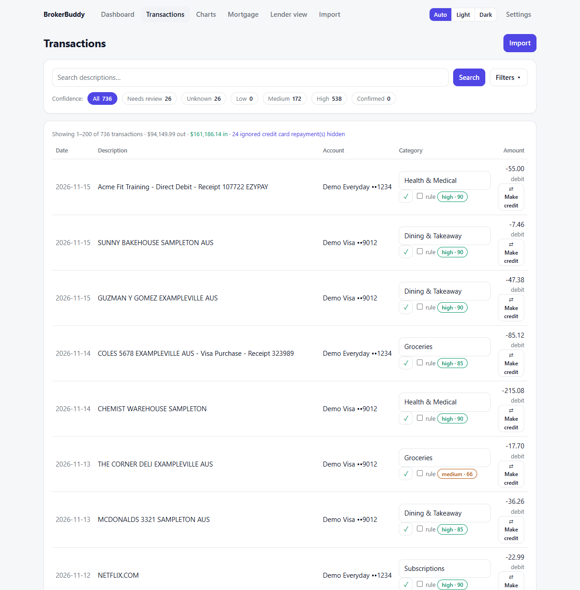
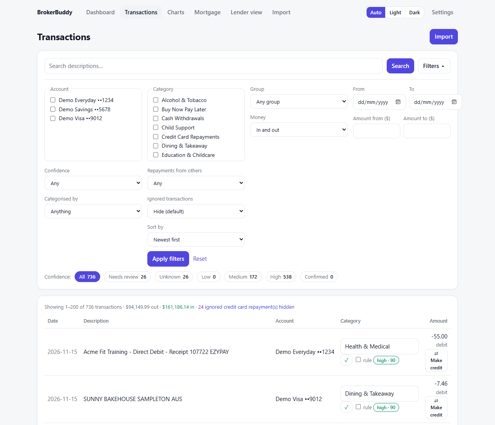
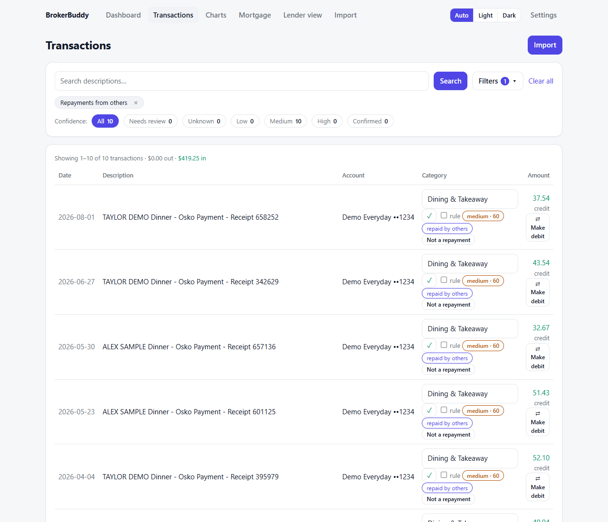

# Transactions

The Transactions page lists everything with search, a collapsed filter menu, inline category editing and the account each row belongs to. Text too long for one line is collapsed with a chevron at the end; click it to expand.

## Filters

Click **Filters** (a badge shows how many are active).

| Filter | Options |
|--------|---------|
| Account | one or several |
| Category | one or several |
| Group | Income, Essential living, Discretionary and so on |
| Money | in and out, money out only, money in only |
| Date range | from and to |
| Amount range | from and to |
| Confidence | confirmed, high, medium, low, unknown, or needs review |
| Categorised by | you, rule, learned, built-in list, lookup, bank, typo match, history, wording cue, not matched |
| Repayments from others | any, only those, only those needing a category |
| Ignored transactions | hide (default), show with the others, only ignored |
| Sort | several orders, including least sure first |

Active filters appear as removable pills under the search box. The confidence chips stay one click away. The page shows how many transactions match and their money out and in totals. Results are paged 200 at a time, and every filter lives in the address, so a filtered view can be bookmarked.

## Editing a category

See [Categorisation](Categorisation#fixing-things). The ✓ button confirms the current suggestion, the box takes any category, and **rule** saves a rule.

## Confidence on each row

Each row shows a badge (*confirmed*, *high · 90*, *medium · 66*, *low · 40*, *unknown*). Hover for the reason, such as "matched the built-in list" or "similar to another transaction".

## Reversing debit and credit

Some bank exports record money going out as a credit, or the reverse. Under the amount, each row shows whether it is a debit or a credit and a button: **Make debit** on credits, **Make credit** on debits.

- The amount's sign is reversed and the row is marked *reversed*.
- Categories, ignored and repayment flags, the dashboard, charts and mortgage figures all update.
- A category you set by hand is kept.
- Re-importing the same file, or re-syncing with Plaid, does not undo or duplicate the correction.
- Press the button again to put it back.

## Repayments from other people

A small credit from another person (a friend paying you back for dinner, a parent for the kids' swimming) is not income. It should reduce spending in the category it relates to.

**Detection.** Credits up to a limit (default $300, set under Settings → Categorisation) with person-to-person wording (`OSKO PAYMENT FROM`, `TRANSFER FROM`, `PAYID FROM`) are flagged *repaid by others*. Never flagged: transfers between your own accounts, credits from savings, loan or investment accounts, salary, benefits, interest and merchant refunds.

**Which category it offsets.** The category of a flagged credit is the spending it offsets. It comes from your earlier choice for that payer, or from the memo: dinner → Dining & Takeaway, swimming → Education & Childcare, petrol → Transport & Fuel, tickets → Entertainment, rent share → Rent. With no clue, the credit is held out of both income and spending, and a banner on the Transactions page lists those so you can type the category it offsets.

**Effect.** Once set, it nets against that category everywhere: dashboard, charts, Lender view and mortgage analysis. The Lender view says how much spending the repayments reduced.

**Manual control.** On any credit, **Repaid by others** flags it by hand and **Not a repayment** undoes an automatic flag (your choice sticks). Automatic detection and its size limit can be switched in Settings.

## Ignored transactions

Credit card repayments are ignored so spending is not counted twice. They stay in the database, appear dimmed with the reason when you choose *Show with the others* or *Only ignored*, and **Count it** includes any of them anyway. See [Credit cards](Credit-Cards-and-Repayments).
